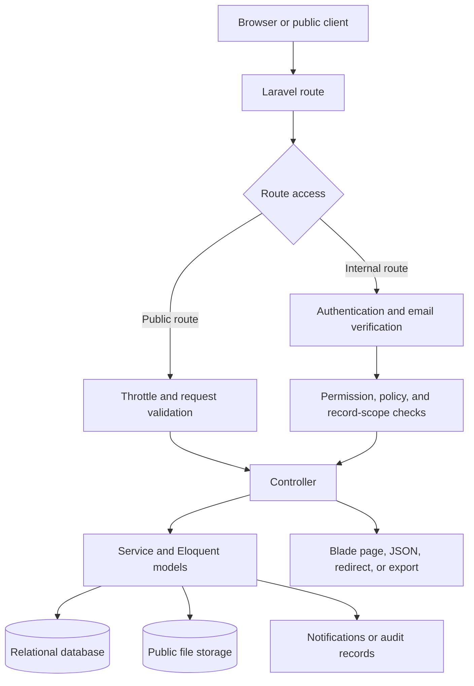
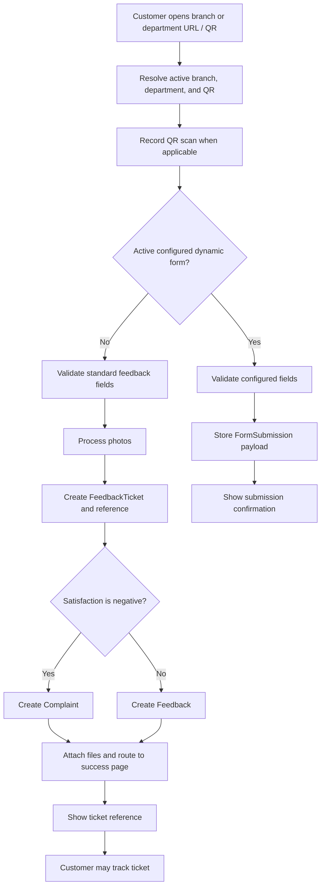
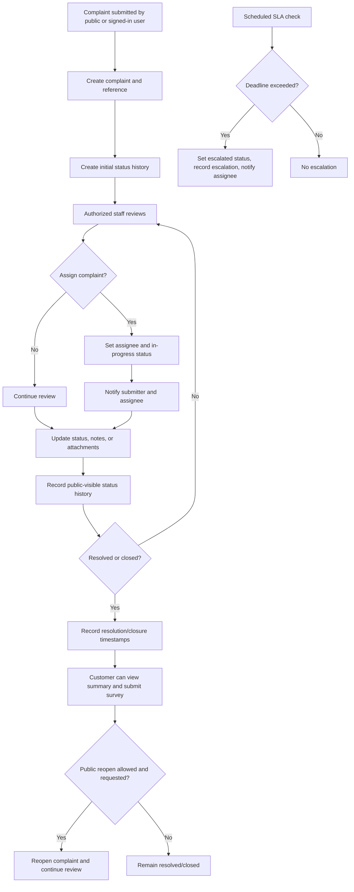
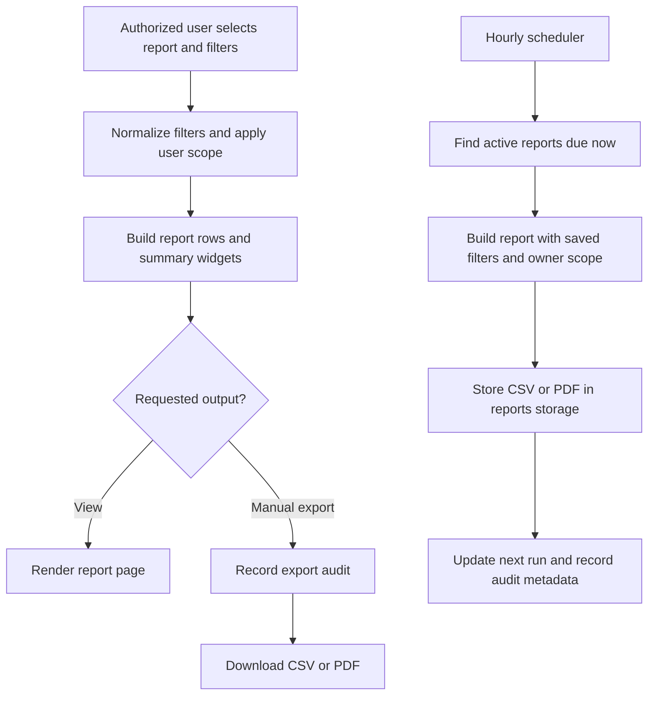

# GLEDCO Feedback Management System — System Documentation

This document describes the system as implemented in the repository. It is intended as a technical overview and a starting point for users, maintainers, and administrators. For installation or task-by-task instructions, use the guides listed in [Documentation Index](README.md).

## 1. Purpose and scope

The application manages customer complaints and feedback, internal employee feedback, public feedback collection, complaint tracking, branch and department administration, reporting, and service-level monitoring. It is a server-rendered Laravel application with role and permission checks, branch/department data scopes, and persistent relational storage.

## 2. Technology and runtime

- **Backend:** PHP 8.2+ and Laravel 12.
- **UI:** Blade templates, Tailwind CSS, Alpine.js, and Vite assets.
- **Identity and access:** Laravel Breeze authentication and Spatie Permission roles/permissions.
- **Persistence:** Laravel Eloquent and migrations; the repository includes SQLite database files, while configuration also supports other Laravel database drivers.
- **Files:** Laravel public storage for feedback photos, attachments, and generated scheduled report files.
- **Exports:** CSV and PDF (Dompdf).
- **Optional realtime infrastructure:** Laravel Reverb is a dependency; availability/use depends on environment configuration.

The request path is: browser or public client → Laravel route and middleware → controller/form request → policy/service/model → database or storage → Blade/JSON/download response. Scheduled commands are invoked through Laravel's scheduler configuration in `bootstrap/app.php`.

## 3. System users and access model

Authentication is required for internal management routes. Most internal pages require a verified email and use the `force.ssl` middleware. Public feedback and complaint tracking routes are available without signing in and have route-level throttles.

Roles seeded by the application are `Super Admin`, `Admin`, `Department Head`, `Supervisor`, `Employee`, and `Customer`. Permissions include user, branch, complaint, feedback, report, setting, and form management; dashboard access; complaint assignment/closure/reopening; and submission/tracking permissions. The exact grants are defined in `database/seeders/RolesAndPermissionsSeeder.php` and may be changed by administrators.

Some roles are also record-scoped:

- A Department Head with a department assignment is limited to that department for scoped workflows.
- A Supervisor is branch-scoped.
- Employees and customers generally see records they submitted or are assigned, depending on the module.
- Broad administrators can manage across scopes when their permissions and role allow it.

Middleware, policies, and query-level filters work together; a menu item alone does not grant access. See the role seeder, `User` model, policies, and `EnsureBranchAccess` middleware for implementation details.

## 4. Functional modules

### 4.1 Authentication and profile

Breeze routes provide registration, login/logout, email verification, password reset, password confirmation, password update, and profile maintenance. Protected application routes require an authenticated session; verified routes additionally require email verification.

### 4.2 Customer feedback and QR entry

The public feedback index lists active branches and departments. A branch or department URL displays its feedback form. QR codes point to these public URLs; the admin QR page synchronizes branch and department QR records, shows scan/download metrics, and supports PNG/SVG download and printing. QR image generation calls an external QR image provider at request time.

When a standard public feedback form is submitted, the application validates input, processes uploaded photos, and creates a `FeedbackTicket` with an `FBK-...` reference. The satisfaction choice routes a negative response to a Complaint record and other responses to a Feedback record. A dynamic form, when active and populated for the branch, instead stores its answers as a `FormSubmission`. Ticket lookup is available by reference or selected customer details, and a reference page shows an individual submission.

### 4.3 Complaint management and public tracking

Authenticated complaint users can list, submit, view, edit, archive (soft delete), assign, close, and reopen complaints as allowed by policies and permissions. Complaints may be associated with a branch, department, submitter, assignee, attachments, SLA escalations, and status history. A generated reference begins `GLD-` and includes the year.

The public tracker accepts a tracking number, displays public-visible complaint status history and resolution information, and can collect a satisfaction survey. Eligible complaints can be reopened publicly according to the complaint's public-reopen flag and request rules. These routes are throttled. Internal-only data should not be exposed through the public tracker.

### 4.4 Internal feedback and employee feedback

The general Feedback module supports submitting, viewing, updating, and archiving feedback. Negative feedback from a Customer is routed into the complaint workflow. Attachments are stored through a shared attachment service and associated polymorphically with feedback or complaints.

Employee Feedback is a distinct workflow for employee-submitted issues or suggestions. It supports branch/department scoping, anonymity, priority, attachments, internal notes, status transitions, reopening/closing, status-history records, and in-app notifications. Reference numbers begin `EFB-`.

### 4.5 Dashboard and search

The dashboard presents complaint totals, pending/resolved/escalated/reopened counts, trends, status/category distributions, branch and product analytics, and SLA indicators. Query filters include branch, product, status, category, and date range. Metrics are cached for a short period and scoped to the signed-in user. Global search provides an authenticated search entry point.

### 4.6 Reports and scheduled exports

The reporting module supports complaint summary, branch performance, product/services, SLA performance, employee feedback, complaint trends, reopened complaints, escalation reports, and branch rankings. Available filters are normalized by the report service. Users with report permission can export PDF or CSV; manual and scheduled exports create audit records.

Scheduled reports store report type, format, frequency, filters, recipient list, owner, and next run time. The scheduled command generates due files into public storage under `reports/`, updates run times, and records an audit log. The current command records recipients in audit metadata; this implementation does not itself send report emails.

### 4.7 SLA monitoring and settings

Administrators can manage category-based SLA hours and system settings. The SLA monitor evaluates active complaints against configured hours (falling back to a default) and escalates overdue items, recording an escalation and attempting an in-app notification to the assignee. Scheduler wiring currently registers `sla:check` every fifteen minutes and `reports:run-scheduled` hourly in `bootstrap/app.php`.

### 4.8 Administration and reference data

Administrative pages manage users, roles, settings, SLA configuration, QR codes, and dynamic forms. Branches, departments, and products provide organizational/reference data used by feedback forms, access scopes, reports, and QR entry. Products are associated with branches through a many-to-many relationship. Business type is a deprecated/removed feature in current code.

### 4.9 Notifications, attachments, and localization

The notification area provides a feed and read/read-all actions. Complaint status or assignment changes notify the submitter and assignee when those users exist; Employee Feedback workflow actions also notify relevant users. Attachment routes support preview, download, and deletion subject to authentication/authorization. English, Filipino, and Ilocano translation resources are present.

## 5. Main data concepts

| Entity | Purpose and important relationships |
|---|---|
| User / Role / Permission | Login identity, optional branch and department assignment, role-based privileges, and notification recipient. |
| Branch | Organizational location; owns departments, complaints, feedback, products, QR code, and optional public form. |
| Department | Belongs to a branch; provides additional routing and reviewer scope. |
| Product | Reference item associated with one or more branches. |
| Complaint | Operational issue with customer data, status, priority, assignment, due/resolution dates, and reference number. |
| ComplaintStatusHistory | Timeline entries; entries can be flagged for public visibility. |
| Feedback | General customer or internal feedback record. |
| FeedbackTicket | Public submission/tracking record with satisfaction, reference, customer contact, photos, and QR source. |
| EmployeeFeedback | Internal employee-submitted workflow with status history, notes, and optional attachment. |
| Attachment | Polymorphic file association for supported record types. |
| Form / FormField / FormSubmission | Configurable branch form definition, its fields, and submitted JSON payload. |
| QrCode / QrCodeScan | Branch or department public entry URL and scan/download metrics. |
| SlaConfig / SlaEscalation | SLA hours by category and automatically created escalation records. |
| ScheduledReport / ReportAuditLog | Export schedule, execution metadata, and audit history. |
| Setting | Configurable system-level values such as branding and defaults. |

## 6. Flowcharts

### 6.1 Overall system request flow

### 6.2 Public feedback submission and routing

### 6.3 Complaint lifecycle and SLA

### 6.4 Reporting and scheduled export

## 7. Route and code map

| Area | Main implementation locations |
|---|---|
| Web and authentication routes | `routes/web.php`, `routes/auth.php` |
| Authentication | `app/Http/Controllers/Auth/` |
| Public feedback | `PublicFeedbackController`, `StorePublicFeedbackRequest`, `public-feedback` views |
| Complaints and public tracking | `ComplaintController`, `TrackComplaintController`, `PublicComplaintTrackingService`, complaint/track views |
| General and employee feedback | `FeedbackController`, `EmployeeFeedbackController`, `app/Services/EmployeeFeedback/` |
| Dashboard and search | `DashboardController`, `DashboardAnalyticsService`, `GlobalSearchController` |
| Reports and SLA | `ReportController`, `app/Services/Reports/`, `SlaMonitorService`, `app/Console/Commands/` |
| Administration | `app/Http/Controllers/Admin/`, branch/department/product controllers |
| Domain models | `app/Models/` |
| Schema and default roles | `database/migrations/`, `database/seeders/` |
| Scheduled task registration | `bootstrap/app.php` |

## 8. Operations and data handling

- Apply schema changes with Laravel migrations for the configured environment.
- Configure database, mail, session, cache, filesystem, and application URL in environment settings.
- Create Laravel's public storage link when public-disk files need to be served by the web server.
- Run Laravel's scheduler every minute in the host environment so registered 15-minute and hourly tasks can run on time.
- Back up both the relational database and relevant `storage/app/public` files; they contain separate system data.
- Use HTTPS and disable debug output in production. Public endpoints have throttles, and internal routes use authentication, authorization, and scoped queries.
- See the installation, deployment, maintenance, administrator, and troubleshooting guides for environment-specific procedures.

## 9. Implementation notes and limits

- This guide reflects repository code, not a live production configuration. Database driver, mail delivery, queues, HTTPS enforcement, external QR image availability, and storage exposure depend on environment settings.
- Public ticket lookup and complaint tracking are separate flows: feedback tickets use `FBK-...` references; complaint tracking uses complaint references such as `GLD-...`.
- Dynamic public form responses are stored in `form_submissions`; that path does not create a standard feedback ticket in the current controller flow.
- Scheduled exports are written to storage and audited. The current scheduled command does not deliver the saved export to the listed recipients.
- `app/Console/Kernel.php` contains older scheduler code, while the active Laravel 12 application registers tasks in `bootstrap/app.php`; use the latter as the current scheduler configuration.
